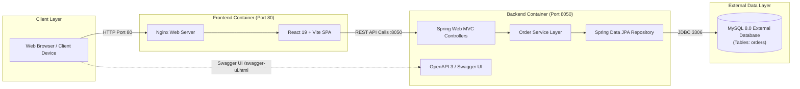
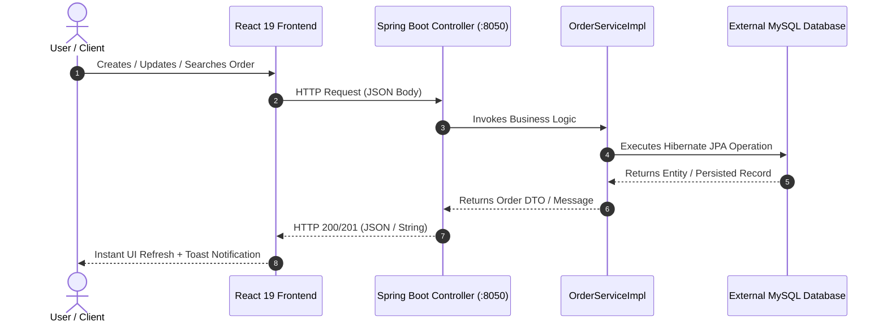

# OrderHub — Enterprise Order Management System (SOA REST API)

[](https://github.com/Rahul2322-P/SOA-OrderManagementSystem-RESTAPI-/actions/workflows/ci-cd.yml)
[](https://openjdk.org/projects/jdk/21/)
[](https://spring.io/projects/spring-boot)
[](https://react.dev/)
[](https://vitejs.dev/)
[](https://tailwindcss.com/)
[](https://hub.docker.com/u/rahul8352)

A full-stack, enterprise-grade **Order Management System** developed with **Java 21**, **Spring Boot**, **Spring Data JPA**, **MySQL**, **Springdoc OpenAPI (Swagger)**, and a modern, responsive **React 19 + Vite + Tailwind CSS** frontend.

Designed with Service-Oriented Architecture (SOA) principles, containerized into **two production Docker images**, and automated via **GitHub Actions CI/CD**.

---

## 📑 Table of Contents

- [System Architecture](#-system-architecture)
- [Key Features](#-key-features)
- [Technology Stack](#-technology-stack)
- [Project Structure](#-project-structure)
- [REST API Reference & Swagger UI](#-rest-api-reference--swagger-ui)
- [Prerequisites](#-prerequisites)
- [Environment Configuration](#-environment-configuration)
- [Local Development Setup](#-local-development-setup)
  - [1. Backend Setup](#1-backend-setup-spring-boot)
  - [2. Frontend Setup](#2-frontend-setup-react--vite)
- [Docker Architecture & Execution](#-docker-architecture--execution)
  - [Image 1: Frontend Container](#image-1-frontend-container)
  - [Image 2: Backend Container](#image-2-backend-container)
  - [Build, Run, Stop & Inspect Commands](#build-run-stop--inspect-commands)
- [GitHub Actions CI/CD Pipeline](#-github-actions-cicd-pipeline)
- [Public Cloud Deployment Guide](#-public-cloud-deployment-guide)
- [Security & Credential Management](#-security--credential-management)
- [Troubleshooting](#-troubleshooting)

---

## 🏛 System Architecture

The application adopts a decoupled full-stack architecture where the React frontend communicates via a centralized Axios client with the Spring Boot REST backend over HTTP/JSON. The backend connects to an external MySQL database without bundled container coupling.



### Request Flow Sequence



---

## ✨ Key Features

### 🖥 Frontend (React 19, Vite, Tailwind CSS)
1. **Interactive Dashboard**: Real-time KPI summary computed dynamically from backend data.
2. **Dynamic Order Metrics**:
   - Total orders count
   - Status breakdown pills: *Pending*, *Processing*, *Shipped*, *Delivered*, *Cancelled*
   - Category distribution progress bars: *Electronics*, *Clothing*, *Groceries*, *Furniture*, etc.
   - Top delivery location ranking
3. **Comprehensive Order Management**:
   - **View Toggle**: Responsive Table View & Grid Card View
   - **Live Search**: Search orders by product/customer name (integrates with `GET /order/displaybyname/{name}`)
   - **Type Filtering**: Filter by product category (integrates with `GET /order/displaybytype/{type}`)
   - **Status Filtering**: Instant filter pills (*All*, *Pending*, *Processing*, *Shipped*, *Delivered*, *Cancelled*)
   - **Sorting**: Sort by Newest, Oldest, Name (A-Z), Order ID
4. **Order Creation & Updates**:
   - Modal-based form with real-time field validation
   - Pre-populated modal for editing existing orders (`PUT /order/update`)
   - Reusable delete confirmation modal (`DELETE /order/delete/{id}`)
5. **Detailed Order Modal**:
   - Inspects full order attributes, formatted timestamps, and raw JSON payload inspection
6. **Robust UX & Notifications**:
   - Floating auto-dismiss toast alerts for Success, Error, and Warning states
   - Loading skeletons and spinners
   - Live backend health status indicator (polls `/order/` health endpoint)
   - Interactive Swagger API reference viewer built into the UI

### ⚙️ Backend (Spring Boot, Java 21, MySQL)
1. **RESTful Architecture**: Clean Separation of Concerns across Entity, Repository, Service, and Controller layers.
2. **Spring Data JPA**: Automated query generation, custom query methods (`findByName`, `findByType`), and schema updates.
3. **Springdoc OpenAPI / Swagger UI**: Built-in interactive documentation at `/swagger-ui.html`.
4. **Configurable CORS**: Global WebMvcConfigurer and Controller-level `@CrossOrigin` supporting custom origins via environment variables.
5. **Secure Database Configuration**: Decoupled database URL, credentials, and Hibernate dialect through environment variables with zero committed secrets.
6. **Automated Unit & Integration Tests**: 21 comprehensive JUnit 5 and Mockito tests covering Service, Controller, and JPA repository layers.

---

## 🛠 Technology Stack

| Layer | Technologies |
| :--- | :--- |
| **Backend** | Java 21, Spring Boot 4.1.0, Spring Web MVC, Spring Data JPA, Hibernate, Maven |
| **Database** | MySQL 8.0 (Externally hosted / local service) |
| **API Docs** | Springdoc OpenAPI Starter WebMVC UI 2.8.9 (Swagger 3) |
| **Testing** | JUnit 5, Mockito, Spring Test (MockMvc), Byte Buddy |
| **Frontend** | React 19, Vite 8.3, Tailwind CSS (via `@tailwindcss/vite`), React Router 7, Axios, Lucide React |
| **Web Server** | Nginx Alpine (Serving production frontend build with SPA fallback) |
| **Containers** | Docker (2 isolated multi-stage production images), Docker Hub |
| **CI/CD** | GitHub Actions (Automated checkout, Java 21, Node 22, Maven test/build, npm build, Docker build/publish) |

---

## 📂 Project Structure

```
OrderManagementSystem/
├── .github/
│   └── workflows/
│       └── ci-cd.yml                # Automated CI/CD Pipeline
├── .mvn/
│   └── wrapper/                     # Maven Wrapper binary configuration
├── frontend/                        # React 19 + Vite Frontend Application
│   ├── public/                      # Static assets
│   ├── src/
│   │   ├── api/
│   │   │   ├── axiosClient.js       # Centralized Axios client with interceptors
│   │   │   └── orderService.js      # API service module for all 8 backend endpoints
│   │   ├── components/
│   │   │   ├── ConfirmModal.jsx     # Delete confirmation modal
│   │   │   ├── Navbar.jsx           # Top header with health indicator & quick actions
│   │   │   ├── Notification.jsx     # Toast notification banner
│   │   │   ├── OrderDetailsModal.jsx# Full order details inspector
│   │   │   ├── OrderFormModal.jsx   # Create & Edit order form with validation
│   │   │   └── StatusBadge.jsx      # Color-coded status badge component
│   │   ├── pages/
│   │   │   ├── ApiDocsView.jsx      # Interactive API reference & Swagger view
│   │   │   ├── Dashboard.jsx        # Analytics KPI cards & recent orders table
│   │   │   └── OrdersList.jsx       # Order directory (Search, filter, table/card views)
│   │   ├── App.jsx                  # Main application routing and state hub
│   │   ├── index.css                # Tailwind CSS imports & global layout styling
│   │   └── main.jsx                 # React root renderer
│   ├── .dockerignore
│   ├── .env.example                 # Frontend environment variables template
│   ├── Dockerfile                   # Multi-stage Dockerfile (Node -> Nginx)
│   ├── nginx.conf                   # Nginx SPA router configuration
│   ├── package.json
│   └── vite.config.js               # Vite bundler configuration with Tailwind plugin
├── src/
│   ├── main/
│   │   ├── java/com/klef/soa/
│   │   │   ├── configuration/
│   │   │   │   ├── CorsConfig.java          # Global CORS configuration
│   │   │   │   └── SwaggerConfig.java       # OpenAPI / Swagger definition
│   │   │   ├── controller/
│   │   │   │   └── OrderController.java     # 8 REST endpoints
│   │   │   ├── entity/
│   │   │   │   └── Order.java               # JPA Entity (orders table)
│   │   │   ├── repository/
│   │   │   │   └── OrderRepo.java           # JpaRepository (findByName, findByType)
│   │   │   ├── service/
│   │   │   │   ├── OrderService.java        # Business interface
│   │   │   │   └── OrderServiceImpl.java    # Business implementation
│   │   │   └── RestApiAssignmentApplication.java # Spring Boot Main class
│   │   └── resources/
│   │       └── application.properties       # Environment variable-backed properties
│   └── test/
│       └── java/com/klef/soa/
│           ├── controller/
│           │   └── OrderControllerTest.java # 10 MockMvc controller endpoint tests
│           ├── service/
│           │   └── OrderServiceTest.java    # 10 Mockito service unit tests
│           └── RestApiAssignmentApplicationTests.java # Context load integration test
├── .dockerignore
├── .env.example                     # Root backend environment variables template
├── .gitignore                       # Strict ignore rules (ignores .env, credentials)
├── Dockerfile                       # Multi-stage Dockerfile for Backend (Java 21 JRE)
├── mvnw / mvnw.cmd                  # Maven wrappers
├── pom.xml                          # Maven dependencies & build plugins
└── README.md                        # Complete project documentation
```

---

## 📡 REST API Reference & Swagger UI

### Swagger UI Access
When the backend is running, the interactive Swagger documentation and testing console is available at:
- **Swagger UI**: `http://localhost:8050/swagger-ui.html`
- **OpenAPI 3 JSON Spec**: `http://localhost:8050/v3/api-docs`

### Endpoint Specifications

| Method | Endpoint | Description | Request Body / Parameters | Response Status & Body |
| :--- | :--- | :--- | :--- | :--- |
| `GET` | `/order/` | Health check & service demo | *None* | `200 OK` → `"Spring Boot Project"` |
| `POST` | `/order/add` | Insert a new order | JSON: `{ "name", "type", "status", "location" }` | `201 CREATED` → `Order` JSON (with ID & timestamps) |
| `GET` | `/order/displayall` | Retrieve all orders | *None* | `200 OK` → `List<Order>` JSON |
| `GET` | `/order/display` | Fetch single order by ID | Query Param: `?id={id}` | `200 OK` → `Order` JSON / `404 NOT FOUND` |
| `PUT` | `/order/update` | Update existing order | JSON: `{ "orderId", "name", "type", "status", "location" }` | `200 OK` → updated `Order` / `404 NOT FOUND` |
| `DELETE` | `/order/delete/{id}` | Delete order by ID | Path Variable: `{id}` | `200 OK` → `"Order Deleted Successfully"` |
| `GET` | `/order/displaybyname/{name}` | Search orders by name | Path Variable: `{name}` | `200 OK` → `List<Order>` JSON |
| `GET` | `/order/displaybytype/{type}` | Filter orders by category | Path Variable: `{type}` | `200 OK` → `List<Order>` JSON |

#### Example Order JSON Payload
```json
{
  "orderId": 1,
  "name": "Apple MacBook Pro 16 M3",
  "type": "Electronics",
  "status": "Processing",
  "location": "Seattle, WA",
  "createdAt": "2026-10-27T10:15:30",
  "updatedAt": "2026-10-27T10:18:45"
}
```

---

## 📋 Prerequisites

Before running the project locally, ensure you have:
- **Java Development Kit (JDK)**: Version 21 or higher (`java -version`)
- **Node.js**: Version 18.x or 20.x or 22.x (`node -v`)
- **npm**: Version 9.x or higher (`npm -v`)
- **MySQL**: Running MySQL server instance on port 3306 or access to a hosted cloud MySQL database (e.g. Aiven, PlanetScale, AWS RDS)
- **Docker** *(Optional, for containerized execution)*: Docker CLI and engine version 24+

---

## 🔐 Environment Configuration

Create a local `.env` file in the project root by copying from `.env.example`:

```bash
cp .env.example .env
```

### Environment Variables Reference Table

| Variable | Default Value | Description |
| :--- | :--- | :--- |
| `SERVER_PORT` | `8050` | Port for Spring Boot REST server |
| `SPRING_DATASOURCE_URL` | `jdbc:mysql://localhost:3306/soataskdb` | JDBC Connection URL to external MySQL DB |
| `SPRING_DATASOURCE_USERNAME` | `root` | Database user |
| `SPRING_DATASOURCE_PASSWORD` | *(empty/configured)* | Database password |
| `SPRING_JPA_HIBERNATE_DDL_AUTO` | `update` | Hibernate schema strategy (`update`, `validate`, `none`) |
| `CORS_ALLOWED_ORIGINS` | `http://localhost:5173,http://localhost:3000,http://localhost:80` | Comma-separated list of authorized frontend origins |
| `VITE_API_BASE_URL` | `http://localhost:8050` | API Base URL consumed by Vite React frontend |

> [!IMPORTANT]
> The `.env` file is strictly ignored by Git to prevent exposing credentials. Never commit passwords or database secrets to the repository.

---

## 🚀 Local Development Setup

### 1. Database Initialization
Ensure your MySQL server is running and create the database `soataskdb`:

```sql
CREATE DATABASE IF NOT EXISTS soataskdb;
```
Spring Boot Hibernate with `ddl-auto=update` will automatically create the `orders` table and its columns on first boot.

### 2. Backend Setup (Spring Boot)

Navigate to the project root directory:

```bash
# Verify compilation and run all 21 test suites
./mvnw clean test

# Package the application JAR
./mvnw clean package -DskipTests

# Run the Spring Boot application (Port 8050)
./mvnw spring-boot:run
```
*(On Windows PowerShell, use `.\mvnw.cmd` instead of `./mvnw`)*

The backend will start at:
- REST API Base: `http://localhost:8050/order/`
- Swagger UI: `http://localhost:8050/swagger-ui.html`

### 3. Frontend Setup (React + Vite)

Open a new terminal window:

```bash
# Navigate to the frontend directory
cd frontend

# Install dependencies cleanly
npm install

# Start the Vite development server (Port 5173)
npm run dev
```

Open your browser and navigate to:
👉 **`http://localhost:5173`**

---

## 🐳 Docker Architecture & Execution

This project provides **exactly two production application Docker images**. It does **not** create a bundled MySQL container or docker-compose, ensuring both frontend and backend are independently deployable and connect to externally hosted databases.

### Image 1: Frontend Container
- **Docker Hub Repository**: `rahul8352/order-management-frontend:latest`
- **Base**: `node:22-alpine` (builder) → `nginx:alpine` (production web server)
- **Features**: Production build, Nginx SPA router, gzip compression, static asset caching.
- **Port Exposed**: `80`

### Image 2: Backend Container
- **Docker Hub Repository**: `rahul8352/order-management-backend:latest`
- **Base**: `eclipse-temurin:21-jdk-alpine` (builder) → `eclipse-temurin:21-jre-alpine` (runtime)
- **Features**: Non-root `appuser`, healthcheck probe, parameterized DB connection.
- **Port Exposed**: `8050`

---

### Build, Run, Stop & Inspect Commands

#### 1. Build Both Docker Images Locally

```bash
# Build Backend Image (from project root)
docker build -t rahul8352/order-management-backend:latest .

# Build Frontend Image (from frontend directory)
docker build -t rahul8352/order-management-frontend:latest ./frontend
```

#### 2. Run Both Containers

```bash
# Run Backend Container (connecting to your external MySQL host)
docker run -d \
  --name order-backend \
  -p 8050:8050 \
  -e SPRING_DATASOURCE_URL="jdbc:mysql://<YOUR_MYSQL_HOST>:3306/soataskdb" \
  -e SPRING_DATASOURCE_USERNAME="root" \
  -e SPRING_DATASOURCE_PASSWORD="<YOUR_DB_PASSWORD>" \
  -e CORS_ALLOWED_ORIGINS="*" \
  rahul8352/order-management-backend:latest

# Run Frontend Container
docker run -d \
  --name order-frontend \
  -p 80:80 \
  rahul8352/order-management-frontend:latest
```

*(Note for local testing on Windows/Mac: Use `host.docker.internal` as the DB host to point to your local machine's MySQL server: `jdbc:mysql://host.docker.internal:3306/soataskdb`)*

#### 3. Inspect Running Containers & Logs

```bash
# Check container status
docker ps

# Inspect backend logs
docker logs -f order-backend

# Inspect frontend Nginx logs
docker logs -f order-frontend

# Inspect container healthcheck status
docker inspect --format='{{json .State.Health}}' order-backend
```

#### 4. Stop and Remove Containers

```bash
# Stop containers
docker stop order-frontend order-backend

# Remove containers
docker rm order-frontend order-backend
```

#### 5. Authenticate and Push to Docker Hub

```bash
# Securely login to Docker Hub
docker login -u rahul8352

# Push Backend Image
docker push rahul8352/order-management-backend:latest

# Push Frontend Image
docker push rahul8352/order-management-frontend:latest
```

---

## 🔄 GitHub Actions CI/CD Pipeline

The repository includes a production-grade CI/CD pipeline at `.github/workflows/ci-cd.yml`.

### Workflow Stages:
1. **`backend` Job**:
   - Spins up a dedicated MySQL 8.0 service container
   - Configures Java 21 Temurin
   - Runs all 21 unit and integration tests (`mvnw test`)
   - Packages the Spring Boot executable JAR and uploads build artifacts
2. **`frontend` Job**:
   - Sets up Node.js 22
   - Installs dependencies via `npm ci`
   - Compiles production React assets via `npm run build`
   - Uploads distribution artifacts
3. **`docker` Job**:
   - Triggers upon successful completion of backend & frontend jobs
   - Initializes Docker Buildx
   - Builds both Docker images (`rahul8352/order-management-backend` & `rahul8352/order-management-frontend`)
   - If secrets `DOCKERHUB_USERNAME` and `DOCKERHUB_TOKEN` are configured, securely publishes both images to Docker Hub with `latest` and commit SHA tags.

### Configuring Docker Hub Publishing in GitHub Actions
1. Navigate to your GitHub repository: `https://github.com/Rahul2322-P/SOA-OrderManagementSystem-RESTAPI-`
2. Go to **Settings** → **Secrets and variables** → **Actions**.
3. Add the following repository secrets:
   - `DOCKERHUB_USERNAME`: `rahul8352`
   - `DOCKERHUB_TOKEN`: *Your Docker Hub Personal Access Token (generate at hub.docker.com → Account Settings → Security → New Access Token)*

---

## 🌐 Public Cloud Deployment Guide

To make the application accessible to your friends via a public web link:

### Option A: Free Cloud Deployment via Render / Railway (Recommended)
1. **Database (MySQL)**:
   - Create a free cloud MySQL database on [Aiven](https://aiven.io/) or [Railway](https://railway.app/).
   - Copy the external JDBC connection string, username, and password.
2. **Backend**:
   - Deploy as a Web Service on Render or Railway pointing to Docker image `rahul8352/order-management-backend:latest` or connecting directly to your GitHub repo.
   - Set environment variables:
     - `SERVER_PORT`: `8050`
     - `SPRING_DATASOURCE_URL`: `<cloud_mysql_jdbc_url>`
     - `SPRING_DATASOURCE_USERNAME`: `<cloud_mysql_user>`
     - `SPRING_DATASOURCE_PASSWORD`: `<cloud_mysql_password>`
     - `CORS_ALLOWED_ORIGINS`: `*`
   - Note the assigned public URL (e.g., `https://order-backend.onrender.com`).
3. **Frontend**:
   - Deploy on [Vercel](https://vercel.com/) or [Render](https://render.com/) pointing to the `frontend/` directory (or running the Docker image `rahul8352/order-management-frontend:latest`).
   - Set environment variable:
     - `VITE_API_BASE_URL`: `https://order-backend.onrender.com`
   - Share the public frontend URL with your friends!

### Option B: Cloud Virtual Machine / VPS (AWS EC2 / DigitalOcean)
On any Ubuntu server with Docker installed:
```bash
# Pull published images
docker pull rahul8352/order-management-backend:latest
docker pull rahul8352/order-management-frontend:latest

# Run containers
docker run -d --name backend --restart always -p 8050:8050 \
  -e SPRING_DATASOURCE_URL="jdbc:mysql://<external_db>:3306/soataskdb" \
  -e SPRING_DATASOURCE_USERNAME="root" \
  -e SPRING_DATASOURCE_PASSWORD="<password>" \
  -e CORS_ALLOWED_ORIGINS="*" \
  rahul8352/order-management-backend:latest

docker run -d --name frontend --restart always -p 80:80 \
  rahul8352/order-management-frontend:latest
```

---

## 🔒 Security & Credential Management

> [!CAUTION]
> **Credential Exposure Notice & Recommendation**:
> The initial repository code contained a hardcoded database password (`Rahul@2322`) in `application.properties`. 
> 
> **Actions Taken**:
> 1. All hardcoded credentials have been completely removed from `application.properties` and refactored to read from `SPRING_DATASOURCE_PASSWORD` and other environment variables.
> 2. An `.env.example` file has been provided with safe placeholders.
> 3. `.gitignore` has been updated to strictly prevent tracking of any `.env` or secret files.
> 
> **Recommendation**:
> Because `Rahul@2322` was present in previous commits, we strongly recommend rotating your MySQL database password if that database is exposed beyond your local development machine.

---

## 🛠 Troubleshooting

| Problem | Cause | Solution |
| :--- | :--- | :--- |
| **CORS Error in Browser** | Frontend origin blocked by backend | Ensure `cors.allowed-origins` contains the frontend URL or `*`. Both `CorsConfig.java` and `@CrossOrigin` on `OrderController` are pre-configured to allow all origins. |
| **Cannot connect to backend server** | Backend not running or wrong port | Verify the backend is running on port 8050: `curl http://localhost:8050/order/`. Check `VITE_API_BASE_URL` in `frontend/.env`. |
| **MySQL CommunicationsException** | MySQL server not reachable | Ensure MySQL is running on port 3306: `Get-Service -Name MySQL80` (Windows) or check cloud DB connectivity. |
| **Docker container cannot reach host MySQL** | `localhost` inside container refers to container itself | When running Docker on local machine, set `SPRING_DATASOURCE_URL=jdbc:mysql://host.docker.internal:3306/soataskdb`. |
| **Nginx 404 on direct route navigation** | SPA router fallback missing | Handled by `frontend/nginx.conf` via `try_files $uri $uri/ /index.html;`. |

---

## 👤 Author & Maintainer

- **Developer**: Rahul
- **GitHub**: [@Rahul2322-P](https://github.com/Rahul2322-P)
- **Repository**: [SOA-OrderManagementSystem-RESTAPI-](https://github.com/Rahul2322-P/SOA-OrderManagementSystem-RESTAPI-)
- **Docker Hub**: [rahul8352](https://hub.docker.com/u/rahul8352)
